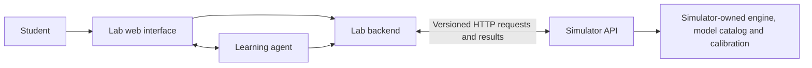

# Simulator API integration review

Status: **HTTP connectivity works; the three course tasks are not integrated.**
Tested upstream version: **1.19.0**, commit
[`fc6379ff66dd58362a06cb27ae0f1366347e5df9`](https://github.com/eyuansu62/mlsys-simulator/tree/fc6379ff66dd58362a06cb27ae0f1366347e5df9).

The checkout is a sibling of this repository, `../mlsys-simulator`. It is
unmodified. No simulator code or dependency was added to the application,
browser or agent. The current lab backends and task traces remain unchanged.

## Service boundary



The student and agent choose model/hardware identifiers, serving policies and
workloads. The simulator service resolves architecture, device rates,
calibration and execution. The lab retains conversations, run history,
references, comparisons, shared metric evaluation and reports. It must not
implement a second simulator scheduler or infer missing model architecture.

The scripts in this directory's parent repository are **development probes**,
not an installed performance backend. The application does not import or call
them. The HTTP probe uses only the Python standard library.

## What was actually tested

| Test against the unchanged HTTP server | Observed outcome |
| --- | --- |
| `GET /api/presets` | HTTP 200 |
| `POST /api/simulate`, Qwen3-1.7B, 8 requests | HTTP 200; all 8 completed in the analytical CPU model |
| Same input and seed again | Identical result and per-request records, excluding wall-time presentation metadata |
| Two simultaneous ordinary simulation requests | One HTTP 200, one HTTP 429 `WEB_BUSY` |
| Exact heterogeneous request list | HTTP 422 `INVALID_WEB_CONFIG` |
| `arrival: sequential` | HTTP 422 `INVALID_WEB_CONFIG` |
| Model ID with a precision selection | HTTP 422; the strategy form has no precision field |
| Replicas or DAG nodes through the form API | HTTP 422 |
| Proposed unchanged task messages for 9.1/9.2/9.3 | HTTP 422 for each; these are compatibility failures |
| Proposed `/v1/capabilities` and `/v1/runs` discovery | HTTP 404; these paths are a proposal, not an existing upstream promise |

The successful smoke test uses a separate, clearly labeled form workload.
It does **not** stand in for any course task. All performance numbers remain
analytical and uncalibrated, not GPU measurements.

The current upstream HTTP service is a single-GPU form API. It generates its
own homogeneous request cohort; it does not accept the lab's frozen trace.
Its CLI/Python API supports substantially more functionality than its HTTP API.
The required changes are summarized in [UPSTREAM_REQUESTS.md](UPSTREAM_REQUESTS.md).

## Reproduce the HTTP checks

Use a new output directory each time. There is no package installation or
change to personal Codex settings.

```bash
# From the common mlsys directory; clone only if the directory does not exist.
git clone https://github.com/eyuansu62/mlsys-simulator.git
git -C mlsys-simulator checkout --detach fc6379ff66dd58362a06cb27ae0f1366347e5df9

# Terminal 1: run the upstream HTTP server, unchanged.
cd mlsys-simulator
../hello-mlsys-lab/.venv/bin/python -m mlsys_sim.web --port 8877

# Terminal 2: run the HTTP-only client from hello-mlsys-lab.
.venv/bin/python scripts/export_simulator_requests.py
.venv/bin/python scripts/probe_simulator_api.py \
  --base-url http://127.0.0.1:8877 \
  --out workspaces/simulator-api-probe
```

`report.json` distinguishes network connectivity from task compatibility.
`requests/` and `responses/` retain full HTTP payloads and outcomes. No API key
is required by the upstream loopback service. A zero probe exit status means
connectivity and deterministic smoke execution succeeded; it does not certify
task integration.

## Materials for the simulator team

- [Requested changes and ownership](UPSTREAM_REQUESTS.md).
- [Proposed HTTP contract](API_PROPOSAL.md), with endpoint names open for agreement.
- [Task 9.1 input](examples/task-9.1.request.json): 6 exact sequential requests.
- [Task 9.2 input](examples/task-9.2.request.json): 12 exact, mixed-length open-loop requests.
- [Task 9.3 input](examples/task-9.3.request.json): 10 exact heterogeneous DAG nodes.
- [Compact observed HTTP evidence](evidence/http-report.json).
- [Public core schema reproductions](evidence/core-gaps.json), distinguishing
  an API exposure gap from missing relative-gap/fixed-stream fields.

The examples preserve each task's baseline choices and every request field.
`catalog_version: to-be-agreed` explicitly marks the unresolved catalog contract;
it is not a usable profile identifier. The baseline `llm-3b` label is still a
placeholder. It must be resolved jointly, not silently replaced with 1.7B or 4B.

After the simulator team exposes the agreed API, the lab can add a normal HTTP
Backend implementation and run the same conformance tests used by existing
backends. Until then, selecting `mlsys` is deliberately not advertised as an
available lab backend.

The simulator team can reproduce the two native schema gaps independently:

```bash
# From the unchanged mlsys-simulator checkout, using only its public Python API.
PYTHONPATH="$PWD" ../hello-mlsys-lab/.venv/bin/python \
  ../hello-mlsys-lab/integrations/mlsys-simulator/reproduce_core_gaps.py
```

This developer-only reproduction uses explicitly synthetic toy timings to
isolate semantics. It is not an application integration path or a course run.
